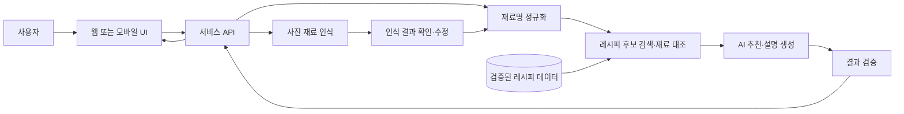

# 냉장고 재료 기반 AI 요리도우미

집에 있는 재료와 요리 숙련도를 입력하면 만들 수 있는 요리를 추천하고, 재료 조합의 이유부터 단계별 조리 방법까지 안내하는 서비스입니다. 냉장고 사진을 첨부해 재료 입력을 돕는 기능도 포함합니다.

## 1. 문제와 목표

요리 경험이 적은 사용자는 보유한 재료로 어떤 메뉴를 만들 수 있는지, 재료가 서로 어울리는지, 어떻게 조리해야 하는지 판단하기 어렵습니다. 이 프로젝트는 **재료 입력 → 메뉴 선택 → 조리 시작**을 한 흐름으로 연결합니다.

### 주요 사용자

| 사용자 | 필요한 도움 | 제공 방식 |
| --- | --- | --- |
| 초보 | 재료 손질, 불 조절, 정확한 순서 | 쉬운 용어와 구체적인 시간·양·주의사항 |
| 중급 | 빠른 메뉴 선택과 조리 요령 | 핵심 단계와 대체 재료 중심 안내 |
| 고급 | 재료 활용 아이디어 | 간결한 조리 순서와 맛 조절 팁 |

## 2. 주요 기능

1. **재료 입력:** 재료명을 직접 입력하거나 냉장고 사진을 첨부합니다. 사진에서 추출된 재료는 사용자가 확인하고 수정합니다.
2. **숙련도 선택:** 초보·중급·고급 중 하나를 선택합니다.
3. **레시피 추천:** 보유 재료로 만들 수 있는 요리를 우선 제시하고, 요리명·사용 재료·예상 시간·난이도·부족한 재료를 요약합니다.
4. **추천 이유:** 재료별 역할과 예상 맛을 쉬운 말로 설명합니다. 예를 들어 “토마토의 산미가 달걀의 부드러운 맛을 살려줍니다.”처럼 표현합니다.
5. **조리 안내:** 인분, 재료의 양, 단계별 시간, 불 세기, 주의할 점을 숙련도에 맞게 표시합니다.
6. **재료 대체:** 부족한 재료와 가능한 대체 재료를 구분하고, 바꿨을 때 맛이나 조리법의 변화를 알려줍니다.
7. **재료 궁합:** 함께 쓰면 맛이 좋아지는 이유를 설명합니다. 건강 관련 효과는 근거가 확인된 경우에만 제한적으로 표시하고, 단정적인 효능 표현은 피합니다.

## 3. 시스템 구조



### 처리 흐름

1. 사용자가 재료, 사진, 숙련도, 인분을 입력합니다. 사진 인식 결과는 확정 전에 수정할 수 있게 합니다.
2. 서버가 재료명을 표준화합니다. 예: `계란`과 `달걀`을 같은 재료로 처리합니다.
3. 레시피 데이터에서 사용 가능 재료의 비율, 부족한 필수 재료 수, 조리 시간, 선택 숙련도에 맞는 난이도를 기준으로 후보를 찾습니다.
4. AI가 후보 중 적절한 요리를 고르고 추천 이유, 대체 방법, 숙련도별 설명을 작성합니다.
5. 서버가 재료 목록·분량·단계의 누락 또는 모순을 검사한 후 결과를 표시합니다. 근거가 부족한 조합이나 대체안은 제외합니다.

### 데이터 구성 예시

| 데이터 | 주요 항목 |
| --- | --- |
| 사용자 입력 | 재료명, 수량(선택), 숙련도, 인분, 제외 재료·알레르기(선택) |
| 레시피 | 요리명, 기준 인분, 필수·선택 재료와 양, 조리 시간, 난이도, 단계, 완성 예시 이미지 |
| 추천 결과 | 사용 가능한 재료, 부족한 재료, 대체안, 추천 이유, 예상 맛, 조리 단계 |

사진은 재료 확인에 필요한 동안만 사용하고, 저장 여부와 보관 기간은 구현 전에 정합니다. 완성 사진은 사용 권한이 확인된 이미지 또는 출처가 명확한 예시 이미지를 사용합니다.

## 4. UI/UX 예시

### 화면 흐름

```text
[재료 입력] → [인식 결과 확인] → [추천 목록] → [레시피 상세] → [단계별 조리]
     ↑              ↑                 ↘ [재료 추가·수정]
  숙련도 선택     사진 오인식 수정
```

### 화면별 구성

| 화면 | 보여줄 내용 | 주요 행동 |
| --- | --- | --- |
| 재료 입력 | 재료 태그 입력창, 사진 첨부, 숙련도, 인분 | 재료 추가·삭제, 추천 요청 |
| 인식 결과 확인 | 사진에서 찾은 재료와 확신이 낮은 항목 | 재료명 수정·삭제·확정 |
| 추천 목록 | 요리 사진/완성 예시, 요리명, 시간, 난이도, 보유 재료 충족도 | 레시피 선택, 조건 변경 |
| 레시피 상세 | 추천 이유, 맛 설명, 재료별 양, 부족한 재료, 대체안 | 조리 시작, 재료 수정 |
| 단계별 조리 | 한 번에 한 단계, 소요 시간, 불 세기, 주의사항 | 이전·다음 단계 이동 |

### 텍스트 화면 예시

```text
┌ 집에 있는 재료로 요리하기 ───────────────────┐
│ 재료  [달걀 ×] [토마토 ×] [대파 ×]  [+ 추가] │
│ [냉장고 사진 첨부]   숙련도: (●초보 ○중급 ○고급) │
│ 인분: [2]                  [요리 추천받기]   │
└─────────────────────────────────────────────┘

추천 결과
┌ 토마토 달걀 볶음 ─────────────────────────────┐
│ 약 15분 · 초보 · 보유 재료 3/3                │
│ 달걀의 부드러움과 토마토의 산미가 어울려요.  │
│ 부족한 재료: 없음       [레시피 보기]         │
└─────────────────────────────────────────────┘
```

**UX 원칙:** 사진 인식 결과를 곧바로 확정하지 않고 수정할 수 있게 합니다. 추천 목록에서는 “지금 만들 수 있음”과 “재료가 더 필요함”을 분명히 구분합니다. 초보자 화면에는 `중불로 2분`처럼 행동과 시간을 함께 쓰고, 단계 진행 중에도 재료와 분량을 다시 확인할 수 있게 합니다. 모바일에서는 큰 버튼과 짧은 문장으로 조리 중 조작을 쉽게 합니다.

## 5. AI 활용 방안

| 단계 | AI의 역할 | 입력 | 출력 및 확인 방법 |
| --- | --- | --- | --- |
| 사진 입력 | 사진 속 재료 후보 인식 | 냉장고 사진 | 재료명 후보와 불확실한 항목 표시; 사용자가 수정 |
| 추천 | 레시피 후보의 재료 조합과 숙련도 적합성 판단 | 확정된 재료, 숙련도, 인분, 레시피 후보 | 추천 순서와 이유; 서버가 실제 재료 충족 여부 재검사 |
| 상세 설명 | 재료의 맛·식감 역할 설명 | 선택한 레시피와 재료 | 짧은 추천 이유와 예상 맛; 근거 없는 효능 표현 검사 |
| 조리 안내 | 숙련도에 맞춰 단계 설명 조정 | 검증된 레시피 단계, 숙련도 | 단계별 시간·양·주의사항; 원본 레시피와 대조 |
| 대체 제안 | 없는 재료의 대체 가능성 설명 | 부족한 재료와 보유 재료 | 대체안, 맛·조리 변화; 필수 재료를 무리하게 대체하지 않음 |

AI가 레시피를 처음부터 임의로 만들어 내기보다는, **검증된 레시피 후보를 검색한 뒤 설명을 생성하는 방식**을 기본으로 합니다. 결과는 구조화된 형식으로 받아 필수 필드 누락을 확인하고, 재료·조리 시간·조리 단계가 서로 맞지 않으면 다시 생성하거나 후보를 제외합니다. 식품 알레르기와 생식·가열 관련 주의사항은 사용자가 쉽게 볼 수 있게 표시합니다.

### 추천 기준 예시

- 보유한 재료만으로 완성 가능한 레시피를 우선합니다.
- 필수 재료가 부족하면 필요한 항목과 대체 가능 여부를 표시합니다.
- 사용자가 선택한 숙련도보다 어려운 레시피는 뒤로 보내거나 제외합니다.
- 비슷한 후보라면 조리 시간이 짧고 보유 재료를 많이 활용하는 요리를 우선합니다.

## 6. 개발 일정 계획

날짜 대신 **주차와 작업 순서**로 계획합니다. 4주짜리 MVP 일정이며, 팀 규모와 사진 인식 방식에 따라 조정할 수 있습니다.

| 기간 | 목표 | 세부 작업 | 완료 기준 |
| --- | --- | --- | --- |
| 1주차: 기획·자료 준비 | 범위와 화면 확정 | 사용자 흐름 작성, 화면 스케치, 레시피 데이터 형식 정의, 예시 레시피 수집, 추천 기준 정리 | 주요 화면 초안과 레시피 샘플 데이터 준비 |
| 2주차: 입력·추천 구현 | 재료로 메뉴 찾기 | 재료 태그 입력, 숙련도·인분 선택, 레시피 검색 및 재료 대조, 추천 목록 UI | 텍스트 재료 입력부터 추천 목록 표시까지 동작 |
| 3주차: 상세 안내 구현 | 추천을 실제 조리로 연결 | AI 추천 이유, 숙련도별 단계, 부족한 재료·대체안, 상세 화면, 사진 입력과 인식 결과 수정 | 선택한 요리의 재료·설명·조리 단계를 확인할 수 있음 |
| 4주차: 검증·발표 준비 | 안정화와 시연 | 다양한 재료 조합 테스트, 사진 오인식 확인, 알레르기·누락 재료 검토, 모바일 사용성 수정, 발표 자료와 시연 시나리오 작성 | 대표 시나리오를 오류 없이 시연하고 알려진 한계를 문서화 |

### 구현 우선순위

1. **필수 MVP:** 텍스트 재료 입력, 숙련도 선택, 검증된 레시피 기반 추천, 상세 조리 방법.
2. **다음 기능:** 부족한 재료와 대체안, 추천 이유와 재료 궁합 설명.
3. **확장 기능:** 냉장고 사진 인식, 완성 예시 이미지, 개인 취향 반영.

### 대표 검증 시나리오

- `달걀·토마토·대파`, 초보: 현재 재료로 만들 수 있는 요리와 자세한 단계가 표시되는지 확인합니다.
- 재료가 하나 부족한 경우: 부족한 재료, 대체 가능 여부, 맛의 변화가 분리되어 표시되는지 확인합니다.
- 흐리거나 여러 재료가 겹친 사진: 인식 결과를 사용자가 수정한 뒤 추천에 반영할 수 있는지 확인합니다.
- 알레르기 재료를 제외한 경우: 해당 재료를 사용하는 레시피가 추천에서 빠지는지 확인합니다.

## 7. 최종 결과물

사용자가 재료와 숙련도를 입력하면 만들 수 있는 요리를 비교하고, 선택한 요리의 재료 조합 이유, 필요한 재료, 대체안, 단계별 조리 방법을 확인할 수 있는 요리도우미입니다.
