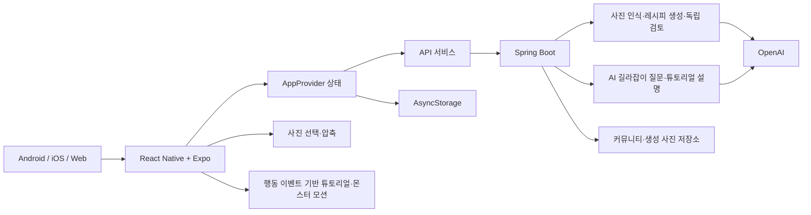

# 시스템 구조

클라이언트는 공개 API 주소만 알고 서버의 OpenAI 키를 받지 않습니다.
재료·설정 입력은 타입과 화면 상태를 통해 관리하며, 최종 검증은 서버에서 수행합니다.
추천 결과는 요청 당시 인분과 함께 저장하고, 기기 북마크는 결과 스냅샷을 보존합니다.

React Native 화면은 공통 도메인 타입과 API를 사용합니다. 사진 접근과 저장소는 Expo 및
AsyncStorage 서비스로 감싸 플랫폼 차이를 화면에서 분리합니다.
API 기본값과 CORS 허용 출처는 README의 환경 설정에 따라 개발/배포 환경별로 정합니다.
